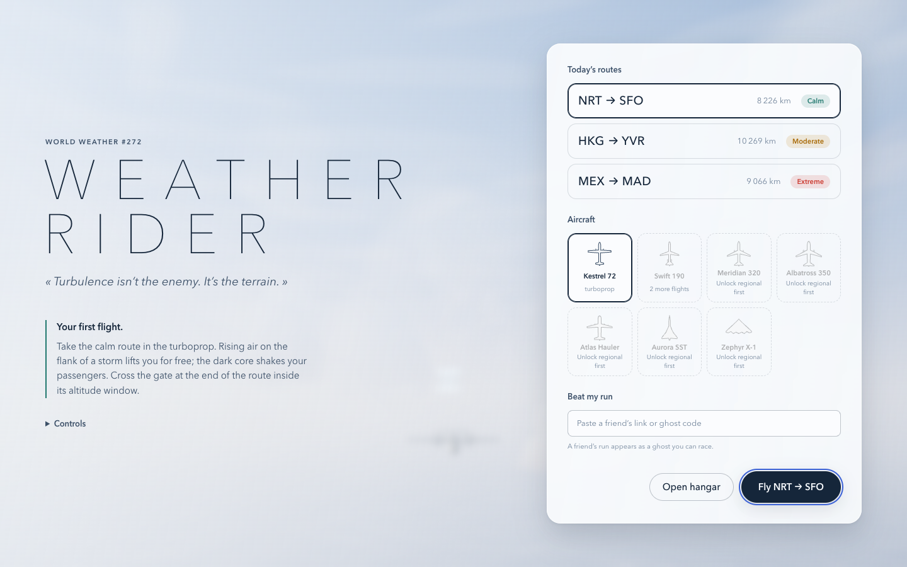
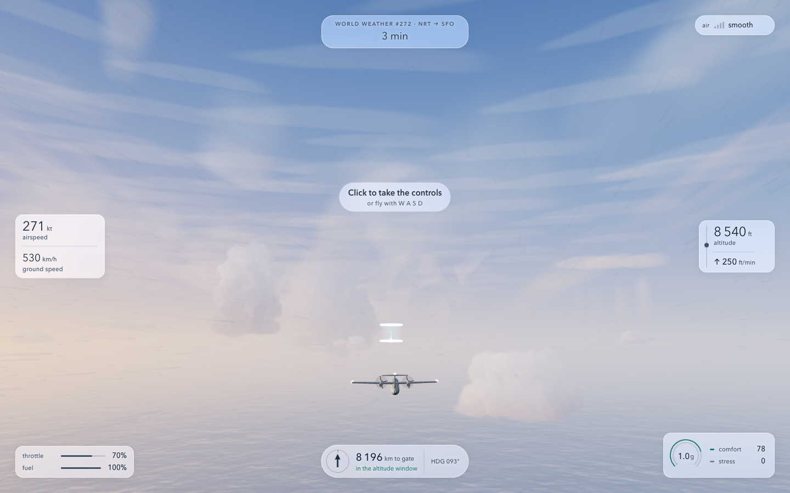
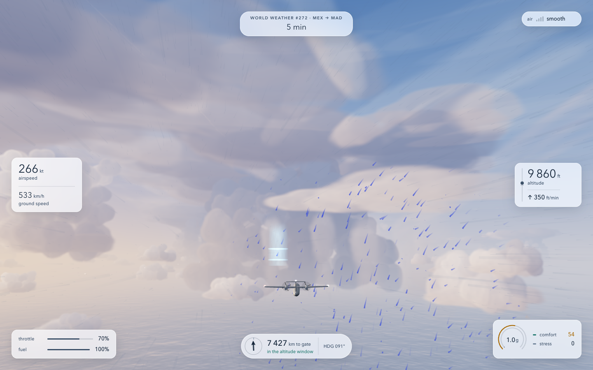
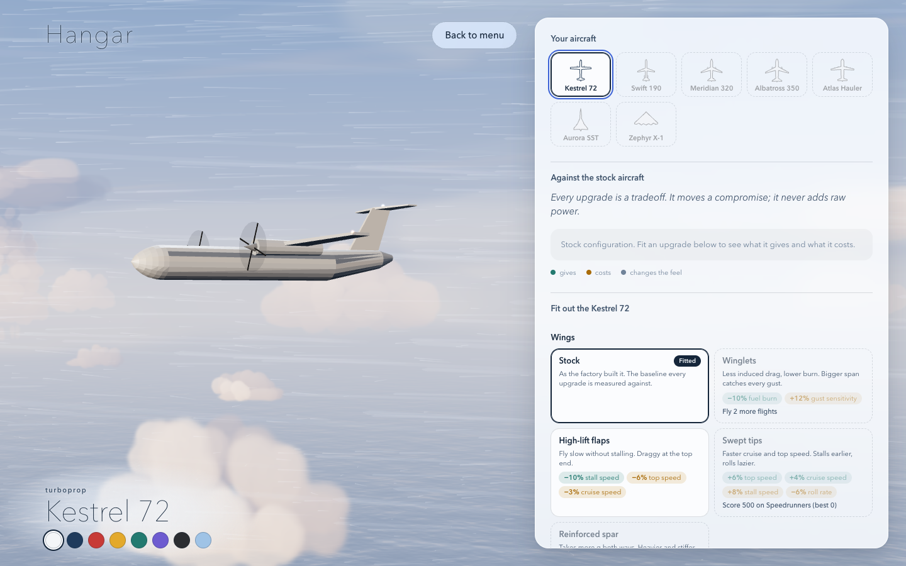

# Weather Rider

> Turbulence isn't the enemy. It's the terrain.

A browser flight game about reading the sky. Catch rising air along a storm, ride a jet stream, and reach the arrival gate with fuel to spare. The fastest route can be a rough ride for your passengers.

Built with TypeScript and Three.js. The game runs entirely in your browser, with progress saved locally.

**Play it: https://sderosiaux.github.io/weather-rider/**

## Screenshots

| Pick a daily route | Follow the air currents |
| --- | --- |
|  |  |

| Fly through storm systems | Choose your aircraft and upgrades |
| --- | --- |
|  |  |

## Play locally

You'll need **Node.js 22.12 or newer**, **pnpm**, and a browser with WebGL2 support.

```sh
git clone https://github.com/sderosiaux/weather-rider.git
cd weather-rider
pnpm install --frozen-lockfile
pnpm dev
```

Open the local URL printed by Vite, usually **http://localhost:5173**.

For your first flight, pick the calm route and the Kestrel 72. Follow the gate indicator and cross the arrival gate inside its altitude window. Rising air can save fuel; the core of a storm costs passenger comfort and adds stress to the aircraft.

## Controls

| Action | Input |
| --- | --- |
| Pitch | `W` / `S` or `↑` / `↓` |
| Roll | `A` / `D` or `←` / `→` |
| Yaw | `Q` / `E` |
| Increase throttle | `Shift`, `R`, or scroll up |
| Decrease throttle | `Ctrl`, `F`, or scroll down |
| Mouse steering | Click the flight view to take control, then move the mouse |
| Return to the menu | `Esc` |

A gamepad also works: left stick to steer, triggers or shoulder buttons for yaw, and the right stick's vertical axis for throttle. **Settings** lets you invert pitch, adjust audio and wind-particle intensity, and toggle coaching hints.

## What's in the game

- **A new sky each day.** Three routes with calm, moderate and extreme weather. The same daily seed produces the same weather for every player.
- **Seven aircraft.** Start with the Kestrel 72 turboprop and unlock regional jets, airliners, a cargo aircraft, a supersonic jet and the Zephyr X-1 motor glider. Each handles wind differently.
- **Three ways to score.** Smooth Pilots rewards comfort, Speedrunners rewards fast arrivals, and Eco Pilots rewards fuel efficiency. Scores account for the aircraft you fly.
- **A hangar with tradeoffs.** Change wings, engines, cabin equipment and liveries. An upgrade can reduce fuel burn while making the aircraft more sensitive to gusts.
- **Ghost runs.** Share a flight as a link or paste a friend's ghost code to race their route through the same sky.

Progress and records live in your browser's local storage. This is a playable prototype; there is no account service, global leaderboard or real-time multiplayer.

## Development

| Command | Purpose |
| --- | --- |
| `pnpm dev` | Start the Vite development server |
| `pnpm typecheck` | Check TypeScript types |
| `pnpm test` | Run the unit tests |
| `pnpm test:watch` | Run tests as you edit |
| `pnpm build` | Typecheck and produce a static build in `dist/` |
| `pnpm lab` | Run the longer flight simulations and balance checks |
| `pnpm bench` | Run performance benchmarks |

The simulation uses seeded randomness and a fixed 60 Hz timestep. Weather, flight, scoring and progression are separate from the renderer and UI. Ghosts record aircraft states at 10 Hz so recorded flights can still play after changes to the flight model.

```text
src/
  core/       Shared types, math and seeded randomness
  weather/    Wind fields, storms and atmospheric layout
  flight/     Aircraft specifications and flight dynamics
  flow/       Wind-particle rendering
  render/     Aircraft, clouds, sea, camera and ghosts
  audio/      Engine, wind and flight cues
  scoring/    Scores and ghost encoding
  meta/       Daily routes, progression and local storage
  ui/         Menus, instruments and input
  game/       The application and flight session
  bot/        Autopilot used by the balance lab
lab/          Headless flight experiments and reports
sandbox/      Individual module demos and screenshots
```

With the dev server running, module demos are available at paths such as `/sandbox/weather.html`, `/sandbox/flight.html` and `/sandbox/render.html`.

See [SPEC.md](SPEC.md) for the game design and architecture decisions, and [the balance log](lab/reports/balance-loop.md) for the flight-model experiments.
